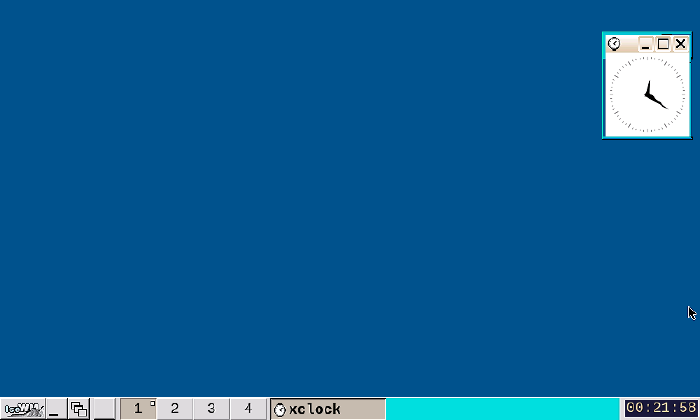
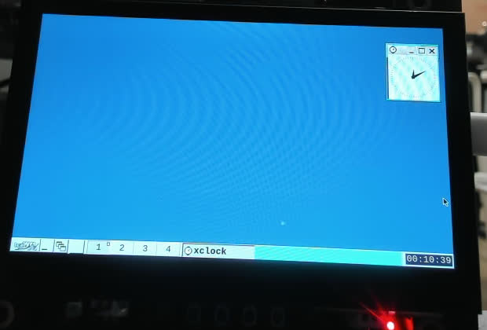
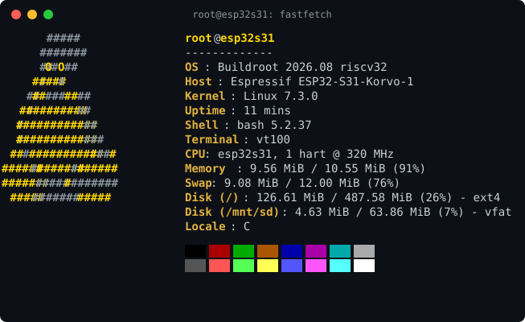

# ESP32-S31 Linux eXtends

**X = X11 + eXtends.** A fork of
[annoyedmilk/esp32-s31-linux](https://github.com/annoyedmilk/esp32-s31-linux)
that puts a **hardware-accelerated X11 desktop** on the ESP32-S31-Korvo-1 —
the thing the upstream project concluded would not fit. 中文说明:
[README-cn.md](README-cn.md)。

> "An X server and a window manager do not fit in the approximately 3 MB
> that are free with Wi-Fi up, so the desktop is the console."
> — upstream, `e33dacb "Make the Korvo-1 a small desktop for a USB keyboard"`

We disagree. This is the board running IceWM with `xclock` — a native
framebuffer dump, not a photo:



*(800x480 LCD, `/dev/fb0` exported and upscaled 3x nearest-neighbor.)*

And here is the actual board on the desk, taken with the webcam that
watches it:



*(Moiré included at no extra charge.)*

`fastfetch` on the merged v0.7.1 base, numbers straight from the board
(note the swap line: 9 MiB of the desktop lives compressed in zram):



## What this fork adds

Everything below is on top of the upstream `v0.5.0`-era base (`3dad844`).

### 1. X11 with real hardware acceleration

The stock `fbdev` X path pushes every pixel through the 320 MHz soft-float
CPU: 15.7 fps for a full-screen fill. This fork adds `xf86-video-s31`, an
EXA driver that maps:

| EXA op | Engine | Measured |
| --- | --- | --- |
| Solid (rect fill) | PPA fill | ~213 MB/s, full-screen fill **89 fps** |
| Copy (screen-to-screen) | DMA2D M2M | ~106 MB/s, scroll **256 fps** |
| Composite | deliberately **not** hooked | PPA blend has fixed per-plane alpha; the a8 glyph masks of a compositor-less desktop cannot be expressed. The full analysis lives in `s31_exa.c`. |

The desktop ships with IceWM, a wallpaper, `xclock`, the GT1151 touch panel
(i2c-gpio polling) and USB keyboard/mouse; `startde` brings it all up at
boot.

| | `esp32s31` (the default) | `coreboard1` | `korvo1` |
| --- | --- | --- | --- |
| Hardware | The ESP32-S31-WROOM-3-N16R16V alone (16 MB flash, 16 MB PSRAM), on any board with UART0 | ESP32-S31-Function-CoreBoard-1 | ESP32-S31-Korvo-1, with the ESP32-S31-WROOM-3-N16R16V |
| Root | squashfs in the flash, with a writable UBIFS overlay (see [Flash root](#flash-root-esp32s31)) | ext4 on the USB stick | ext4 on the microSD card |
| Persistence | All files: the overlay is in the flash | All files on the stick | All files on the card |
| Swap | zram (6 MiB) only | zram (6 MiB), then 64 MiB on p3 of the stick | zram (6 MiB), then 64 MiB on p3 of the stick |
| RAM for Linux (MemTotal) | 12.2 MiB | 11.6 MiB | 10.8 MiB |
| UART console | yes | yes | yes, on the CP2102N USB bridge |
| LCD console, USB keyboard and tmux desktop | no | no | yes |
| Touch (GT1151 on I2C) | no | no | yes |
| Wi-Fi station (`wlan0`): WPA2 and WPA3 Personal | yes | yes | yes |
| Wi-Fi station: WPA2 and WPA3 Enterprise (PEAP, TTLS, TLS) | available | available | available |
| Wi-Fi access point | `wpa_supplicant` | `wpa_supplicant`, `hostapd` | `wpa_supplicant`, `hostapd` |
| Bluetooth (`hci0`): BlueZ, `bluetoothctl` | yes | yes | yes |
| Classic BlueZ tools (`hciconfig`, `hcitool`) | no | yes | yes |
| Gigabit Ethernet (`eth0`) | no | yes | no |
| USB host | no | yes: the root stick, and more storage | yes: keyboards, mice, storage |
| microSD | no | no | yes: the root card |
| RGB LED (`/sys/class/leds/rgb:status`) | no | yes, on GPIO60 | yes, on GPIO37 |
| GPIO, hardware RNG | yes | yes | yes |
| SSH (Dropbear, key only) | yes | yes | yes |
| Userspace | BusyBox, Dropbear, wpa_supplicant, iw, curl, bluetoothctl, iperf3, Lua, the GPIO tools, flash_erase | bash, tmux, vim, nano, gdb, strace, MicroPython, Lua, links, nnn, sqlite3, curl, tcpdump, htop, ethtool and more | A tmux desktop on the LCD, bash, vim, nano, gdb, strace, MicroPython, Lua, links, lynx, irssi, nnn, sqlite3, curl, tcpdump, htop and more |

### 2. The F-only FPU kernel patch and ilp32f flash userspace

Upstream's Limits section says the hardware FPU is not used, because the
hart has F but no D and Linux wants both. This fork carries a kernel patch
(`linux/patches/0017-riscv-f-only-fpu.patch`) that teaches the kernel
`rv32imafc`: FPU context switching and the `hwcap` plumbing. The SD desktop
keeps soft-float `ilp32` binaries for compatibility; the new `korvo1flashf`
profile rebuilds the entire rootfs as **ilp32f**. Programs that explicitly
use F instructions can now print `FPUTEST_PASS` on either path.

| | `esp32s31` (the default) | `coreboard1` | `korvo1` |
| --- | --- | --- | --- |
| Hardware | The ESP32-S31-WROOM-3-N16R16V alone (16 MB flash, 16 MB PSRAM), on any board with UART0 | ESP32-S31-Function-CoreBoard-1 | ESP32-S31-Korvo-1, with the ESP32-S31-WROOM-3-N16R16V |
| Root | squashfs in the flash, with a writable UBIFS overlay (see [Flash root](#flash-root-esp32s31)) | ext4 on the USB stick | ext4 on the microSD card |
| Persistence | All files: the overlay is in the flash | All files on the stick | All files on the card |
| Swap | zram (6 MiB) only | zram (6 MiB), then 64 MiB on p3 of the stick | zram (6 MiB), then 64 MiB on p3 of the card |
| RAM for Linux (MemTotal) | 12.2 MiB | 11.6 MiB | 10.8 MiB |
| UART console | yes | yes | yes, on the CP2102N USB bridge |
| LCD console, USB keyboard and tmux desktop | no | no | yes |
| Touch (GT1151 on I2C) | no | no | yes |
| Wi-Fi station (`wlan0`): WPA2 and WPA3 Personal | yes | yes | yes |
| Wi-Fi station: WPA2 and WPA3 Enterprise (PEAP, TTLS, TLS) | available | available | available |
| Wi-Fi access point | `wpa_supplicant` | `wpa_supplicant`, `hostapd` | `wpa_supplicant`, `hostapd` |
| Bluetooth (`hci0`): BlueZ, `bluetoothctl` | yes | yes | yes |
| Classic BlueZ tools (`hciconfig`, `hcitool`) | no | yes | yes |
| Gigabit Ethernet (`eth0`) | no | yes | no |
| USB host | no | yes: the root stick, and more storage | yes: keyboards, mice, storage |
| microSD | no | no | yes: the root card |
| RGB LED (`/sys/class/leds/rgb:status`) | no | yes, on GPIO60 | yes, on GPIO37 |
| GPIO, hardware RNG | yes | yes | yes |
| SSH (Dropbear, key only) | yes | yes | yes |
| Userspace | BusyBox, Dropbear, wpa_supplicant, iw, curl, bluetoothctl, iperf3, Lua, the GPIO tools, flash_erase | bash, tmux, vim, nano, gdb, strace, MicroPython, Lua, links, nnn, sqlite3, curl, tcpdump, htop, ethtool and more | A tmux desktop on the LCD, bash, vim, nano, gdb, strace, MicroPython, Lua, links, lynx, irssi, nnn, sqlite3, curl, tcpdump, htop and more |

### 3. The calm-desktop fixes, or: fitting a 14 MB working set into 10.6 MiB

Linux gets 10.6 MiB of the 16 MiB PSRAM (kernel, OpenSBI and framebuffer
take the rest). The X desktop working set is ~14 MB. Bringing this up on a
headless server made every failure mode visible:

- **The Wi-Fi auth storm hides in three places.** The ESP-Hosted
  auth-retry loop against an unreachable AP starves the whole 10 MiB
  userspace (~8 minutes to a frozen board, X included). This fork ships
  **no `wpa_supplicant.conf` at all** — neither the Buildroot package
  default (an open-network block that associates with anything) nor a
  template with real credentials on SD p1. Wi-Fi is opt-in: drop your own
  conf on p1, `S40wifi` prefers it. The `NOX` console escape hatch stays.
- **kswapd reclaim livelock.** With the 6 MiB zram cap, anonymous pages
  filled zram, kswapd then reclaimed page cache, and code pages kept
  streaming back from the SD card: 40% iowait, idle 0, load > 5, console
  dead — while every process still existed. Raising zram to 12 MiB (lz4
  compresses ~3x, pool grows on demand) and starting `xterm` only when a
  USB keyboard is attached turned load 5.85 into ~1.0, and the desktop
  came back to life.
- **The RGB status lamp is default-off.** It leaks light into the webcam
  that watches the board (glare and a color cast). `touch RGB` on SD p1
  opts back in. `S70diag` writes 15 minutes of load/cpu/mem samples plus
  an SD read-speed test to p1 at every boot, so the card tells the story
  even when the console is wedged.

### 4. Smaller things

- `icewm` `SKIP_TRANSLATIONS=ON`: the upstream po machinery installs `.mo`
  files with absolute destinations, which host cmake >= 3.28 turns into
  out-of-target pollution (rightly rejected by the buildroot scanner).
- Hardware JPEG codecs with desktop manners (`jpegdec`/`jpegenc` save and
  restore the PPA staging registers, and do not fight X for the screen).
- `fputest-abi`, `s31view`, `scripts/cam-shot.sh` (timestamped webcam shots
  of the board with a fixed-focus profile), `scripts/flash-sd-linux.sh` (the
  macOS-only flash scripts made portable, with SHA-256 readback verify),
  and a fully native non-Docker build path for x86 Linux servers
  (`scripts/soft-icewm-native-build.sh`).

### 5. A small headless SPI-flash profile

`korvo1flashf` is an independent no-X, no-SD Buildroot profile with a direct
ZSTD squashfs root, a persistent UBIFS overlay, an ilp32f userspace and the
existing Zba/Zbb/Zbs instructions. The default `-O2` kernel has
`LD_DEAD_CODE_DATA_ELIMINATION` enabled and is 5,483,192 bytes; the rootfs is
4,124,672 bytes (3.93 MiB). Wired Ethernet, on-demand Bluetooth/SSH and
audio-ready libraries are included; WPA userspace and Matter/OTBR are
outside this first 4 MiB profile. The SD/X line remains intact with its own
loader policy. Upstream v0.7.2 is merged as commit `1b29367`; direct-root
boot, non-audio board acceptance and a 30-minute mixed stability run have all
passed.

See [the flash profile guide](docs/korvo1-flash.md) for the direct-root boot
chain, image validation, backup/readback workflow and current verification
status. Audio hardware testing is blocked until an explicit user request;
Matter/Thread is deferred for RAM/ROM and radio-coexistence reasons.

## Relationship to upstream

This fork diverged before upstream's `v0.6.0` and **merged upstream
v0.7.1** (2026-10-23): the Function-CoreBoard-1 with Ethernet, the native
I2C master driver (the GT1151 touch now runs on hardware I2C instead of
i2c-gpio bitbang), the pin-controller rework, the tmux console desktop
(which coexists with ours: console side theirs, graphical side ours), and
the kernel-source-copy integration. See
[their README](docs/README-upstream.md) for the core-port story. Upstream
still has no X11 and no FPU support — that is what this fork is for.

Notable intentional differences:

- **Wi-Fi is off by default** (see the storm above). Upstream ships a
  template conf; we ship none.
- **The RGB LED is off by default** (`RGB` file on p1 opts in).
- **Swap**: zram 12 MiB, zram-only by default (the card p3 swap machinery
  is retained).
- **Host builds are tested on Linux x64** (Ubuntu 24.04, native, no
  container). The upstream macOS/container flow is still present but not
  exercised by this fork.

## Building (Korvo-1, on a Linux x64 host)

Tested on Ubuntu 24.04, native — no container, no cross-toolchain to
install by hand (Buildroot builds its own).

**Host packages:**

```sh
sudo apt install build-essential bc bison flex gettext rsync unzip cpio \
    patch perl tar python3 file libssl-dev wget git
```

**Build** (first run downloads ~1 GB of sources into `dl/`; on a
metered or censored connection budget for that. Cold build ≈ 25 min on
96 jobs, proportionally longer on smaller machines):

```sh
scripts/soft-icewm-native-build.sh
# → build/artifacts/sdcard-soft-icewm.img  (644 MiB, SHA-256 printed)
```

The script configures Buildroot from `br2-external/configs/korvo1_defconfig`,
verifies the ABI and package set (soft-float ilp32, X11, IceWM, the S31
Xorg driver), builds everything, then re-verifies the produced target
root (Xorg/IceWM/touch/codec binaries present, no `wpa_supplicant.conf`,
LED default-off) before exporting.

**Flash the card** (any 8 GB+ card; whole-disk, erase-all):

```sh
sudo scripts/flash-sd-linux.sh /dev/sdX build/artifacts/sdcard-soft-icewm.img
# or dd the image and run the SHA-256 check yourself
```

**First-time SPI flash.** The card carries the kernel; the SPI flash
carries the second-stage loader, OpenSBI and the Wi-Fi/BT radio firmware.
A board that has never been flashed needs those once:

- Easiest: flash the `flash.bin` from the
  [upstream releases](https://github.com/annoyedmilk/esp32-s31-linux/releases)
  (`esptool --chip esp32s31 -p PORT -b 921600 write-flash 0x0 flash.bin`).
  The upstream loader boots `IMAGE.BIN` from card p1, which is exactly how
  this fork is used.
- Or build it yourself: `make bootloader` (needs ESP-IDF v6.1 with the
  ESP-Hosted patches; see
  [docs/README-upstream.md](docs/README-upstream.md), Host requirements).

**Daily updates are card-only**: write the new image, done. The loader
reads `IMAGE.BIN` from card p1 in preference to the flash kernel.

**Verify after boot** (serial console 115200 baud, root, no password):

```sh
fastfetch        # OS/Kernel/Memory/Swap lines — Swap shows zram at work
fputest          # FPUTEST_PASS (the F-only FPU patch)
startde          # already ran at boot; the LCD shows the IceWM desktop
```

**Check you are running the card kernel**: `dmesg | grep version` — the
build host and date must match your build. If the loader's SD init times
out (rare, seen once in a day of boots) it falls back to the flash kernel
**silently**: the login prompt looks identical and `fputest` will fail
with Illegal instruction. Power-cycle and retry; a loader reflash makes
the fallback disappear.

### Known sharp edges

- Some USB devices wedge the DWC2 host controller in an interrupt-retry
  storm (~8k IRQ/s, system frozen). One specific device is confirmed bad;
  leave USB empty unless you need the keyboard, and watch
  `grep dwc2 /proc/interrupts` when you plug something.
- First Buildroot download can be slow; the `dl/` cache makes later
  builds incremental.
- If you re-run the build as a different user after a container/root run,
  `chown -R` your `dl/` — Buildroot fails with a bare Permission denied.

Serial console 115200 baud, root, no password on the console; SSH is
key-only. `docs/README-upstream.md` documents the loader, the memory map,
the flash layout and the kernel patch set in depth — all of that still
applies.

All the pitfalls, fixes, techniques and design decisions we hit are
written up in [docs/notes.md](docs/notes.md) (Chinese:
[docs/notes-cn.md](docs/notes-cn.md)) — the Wi-Fi storm, the kswapd
livelock, the DWC2 device storm, the EXA decisions, the lot.
applies.

- [x] Merge upstream v0.7.1 (done 2026-10-23; the touch panel now runs on
      hardware I2C, freeing the bitbang CPU slice)
- [ ] FPU on the merged kernel: the F-only patch needs a rework — on the
      upstream base the kernel reports `rv32imac` again (the resolve path
      drops `f` somewhere new); under investigation
- [ ] ilp32f (hardware-F ABI) rebuild; the survey and smoke test are done
- [ ] The dwc2 split-error retry storm on certain USB devices (patch 0014
      needs a companion)
- [ ] The Wi-Fi auth timeout root cause (unfixed upstream too)
## Userspace

The serial and panel consoles log in as root automatically. SSH takes root
only with a key: see [First SSH connection](#first-ssh-connection).

Boot scripts of all boards, in `br2-external/board/esp32s31/rootfs-overlay`
and the overlay of each board:

- `S01clock.sh` sets the clock from `/etc/timestamp` at boot, and saves the
  time there at shutdown. The board has no RTC.
- `S05swap.sh` starts 6 MiB of LZ4 swap in RAM (`/dev/zram0`, priority 100).
  Then, when the MBR gives p3 the type `0x82`, it formats p3 and swaps to
  it at priority 10. The kernel uses the disk only when zram is full. A
  disk without such a p3 swaps to zram only.
- `/etc/sysctl.d/10-reserve.conf` keeps 512 KiB free for the zram writes.
  A larger reserve takes memory from the page cache.
- `S10sdcard.sh` mounts p1 of the disk on `/mnt/sd` or `/mnt/usb`.
- `S10usb.sh` mounts the FAT of a USB stick on `/mnt/usb` on the Korvo-1. It
  makes BusyBox `mdev` the uevent helper of
  the kernel, so a stick that you connect later is also mounted
  (`/etc/mdev.conf`).
- `S40wifi` starts `wpa_supplicant` on `wlan0` in the background, so that
  the console does not wait for it. `S40wifi restart` waits.
- BlueZ (`dbus-daemon` and `bluetoothd`) starts at the first `bluetoothctl`,
  because the two daemons hold memory while idle. `S40bluetooth` starts
  them at boot when a device is paired, so that it can connect.
- `S41ethernet.sh` (Function-CoreBoard-1) makes the stmmac rings smaller, then
  starts DHCP on `eth0` in the background. Its udhcpc hook `wifi-metric` and
  `/etc/sysctl.d/20-linkdown.conf` send the traffic over Ethernet when the
  cable is in, else over Wi-Fi.
- The udhcpc hook sets the clock with NTP on each new lease.
- `S95autostart.sh` runs `autostart.sh` on p1 of the disk, or
  `/root/autostart.sh` when the disk has none.
- `S99banner.sh` prints the line that `make monitor` waits for. The consoles
  show the full kernel log of the boot; after the banner, they show only
  warnings and errors (`dmesg` has all messages).
- `/etc/profile.d/desk.sh` (Korvo-1) starts the tmux desktop at the login on
  `tty1`. Its first window shows `/etc/motd`.
- The module alone also has `overlay-init` and `S00overlay.sh` (see
  [Flash root](#flash-root-esp32s31)).

`login` and SSH show `/etc/motd`, which lists the first commands.

The clock is UTC. On the Korvo-1 and the Function-CoreBoard-1, the zone
database is in `/usr/share/zoneinfo`: `ln -sf
/usr/share/zoneinfo/Europe/Zurich /etc/localtime` sets a local zone for the
programs that start after it. For the tmux clock, run `tmux kill-server` and
log in again. The module alone stays UTC.

The esp32s31 board has only the BusyBox tools and the programs in
[Boards](#boards). The tools below are for the Korvo-1 and the
Function-CoreBoard-1, and the tools marked (Korvo-1) only for the Korvo-1.

### Tools

| Use | Commands |
| --- | --- |
| System | `htop`, `free`, `df -h`, `dmesg`, `file`, `strace`, `gdbserver`, `tmux`, `ncdu` |
| Files | `nnn`, `tree` |
| Network | `ssh`, `scp`, `curl`, `links` (text), `iperf3`, `tcpdump`, `nslookup`, `lynx`, `irssi` (Korvo-1) |
| Code | `micropython`, `lua`, `vim`, `nano`, `sqlite3`, `bc` |
| Hardware | `gpioinfo`, `gpioget`, `gpioset` (libgpiod 2), `lsusb`, `evtest` (Korvo-1) |

The shell is bash, with a history that stays after a reset.

### Flash root (esp32s31)

The ESP32-S31-WROOM-3-N16R16V alone has no card. Its root is in the flash,
as in OpenWrt: a read-only squashfs on `/dev/mtdblock0` (`rootfs`, 7.5 MiB),
and UBIFS on the `data` partition (`/dev/mtd1`, 2.4 MiB) as a writable
overlay over it. `/sbin/overlay-init` mounts the two, then starts init. So
all of `/` is writable, and each change stays: `/etc/wpa_supplicant.conf`,
the SSH host keys, `/root/.ssh` and your own files. The squashfs is at
`/rom`, the data partition at `/overlay`.

```sh
mtdinfo -a                 # the two partitions
df -h /overlay             # free space in the overlay
flash_erase /dev/mtd1 0 0  # then reboot: back to the image
```

Linux cannot drive the SPI flash itself: hart 0 runs its code from it.
Linux reads the partitions through the flash cache, where the firmware on
hart 0 maps them. The firmware programs and erases the flash for Linux
with flash auto-suspend, so Linux runs on while it does.
`make flash` and `flash.bin` do not write `data`, so the overlay stays
after an update. After a change of the partition layout, erase `data`
(for example `esptool erase-region` with its offset and size), so that UBI
formats it again.

### Files and scripts

The paths below are for the Korvo-1. On the Function-CoreBoard-1, p1 is
`/mnt/usb`.

- **Copy files.** From a computer, `scp` and `sftp` work with the key in
  `/root/.ssh/authorized_keys`: `scp file root@<address>:/mnt/sd/`.
- **Web server.** `httpd -f -p 8080 -h /mnt/sd` gives the files of the card
  to a browser, at `http://<address>:8080/<file name>`. It shows no list of
  the files: a directory needs an `index.html`. Stop it with Ctrl-C.
- **Start at boot.** The board runs `/mnt/sd/autostart.sh` at each boot, as
  root. The file is on the FAT partition, so a computer can also write it,
  and it stays after `make sdroot`.

### Examples

`/usr/share/examples` has these examples on all boards: `gpio.sh` reads or
sets a pin, `report.sh` sends the uptime and the free memory with HTTPS
(for `crontab`), `ble-scan.sh` lists the Bluetooth LE devices nearby, and
`ap.sh` starts an access point.  Each board also has a web page in `www/`
(`httpd -p 8080 -h /usr/share/examples/www`) and an `autostart.sh`:

| Board | Web page | `autostart.sh` | Also |
| --- | --- | --- | --- |
| esp32s31 | Sets and reads pins | Starts the web page | |
| coreboard1 | The RGB LED, and the pins of J2 | A green LED, and the web page as a comment | `led.sh` sets the LED |
| korvo1 | The RGB LED | A green LED | `led.py` sets the LED from MicroPython, `touch.sh` prints the touches on the LCD |

The web page has no password: each host that can open it can set the LED
and the pins.  Start it only on a network that you trust.  The kernel
refuses the pins of the flash, the console, the loader and the drivers
(`gpio-reserved-ranges` in the device tree of each board).

## Wi-Fi

`wlan0` works with the standard `wpa_supplicant`. `S40wifi` starts it with
`/etc/wpa_supplicant.conf`, or with `wpa_supplicant.conf` on p1 when that
file exists. `make sdroot` does not delete p1, and a board without a console
can get its network from that file. At each connection, the `wpa_cli` action
script starts or renews the DHCP lease.

```sh
wpa_passphrase "<ssid>" "<passphrase>" >> /etc/wpa_supplicant.conf
/etc/init.d/S40wifi restart
wpa_cli status
wpa_cli scan; wpa_cli scan_results
```

For WPA3 and WPA2/WPA3 networks, the network block needs
`key_mgmt=WPA-PSK SAE`, `ieee80211w=1` and the passphrase as `psk="..."`.
The hex PSK from `wpa_passphrase` is not sufficient for SAE. For WPA3 only,
use `key_mgmt=SAE` with `ieee80211w=2`. Keep the default `sae_pwe=0`: with
`sae_pwe=2`, an access point that answers without H2E is not accepted.

For WPA2-Enterprise (for example eduroam), `wpa_supplicant` has PEAP,
TTLS and TLS, with MSCHAPv2, GTC and MD5 inside. The other EAP methods,
DPP, P2P and TDLS are not built, for flash.

The default configuration has `pmf=1`: protected management frames when
the access point offers them. Without them, a WPA2/WPA3 router gave less
than half of the TX throughput.

On the esp32s31 board, the network stays in the overlay.

For an access point on all boards, stop `S40wifi` and start
`wpa_supplicant -B -D nl80211 -i wlan0 -c /tmp/ap.conf` with a network
block that has `mode=2`, for example `ssid="esp32s31"`, `mode=2`,
`frequency=2437`, `key_mgmt=WPA-PSK`, `proto=RSN`, `pairwise=CCMP`,
`group=CCMP` and `psk="..."`. The Korvo-1 and the Function-CoreBoard-1
also have `hostapd`.

The ESP-Hosted firmware on hart 0 runs the 802.11 MAC. The ESP-Hosted host
driver (`esp32_shm`) is built into the kernel. `wpa_supplicant` runs the
authentication and the key handshakes, and logs to syslog
(`/var/log/messages`). `hostapd` with the nl80211 driver starts an access
point. Stop `S40wifi` first: `wlan0` is a station or an
access point, not the two at the same time.

## Kernel

Buildroot builds a stock kernel release (`BR2_LINUX_KERNEL_CUSTOM_VERSION_VALUE`
in `br2-external/board/esp32s31/defconfig/common.fragment`).

- A hook in `br2-external/external.mk` copies the new source files under
  `linux/` (drivers, device trees, bindings) into the kernel tree.
- Then Buildroot applies `linux/patches/`, which change existing kernel
  files, mostly Kconfig and Makefiles.
- The ESP-Hosted host driver comes from `external/esp-hosted-linux`, with the
  patches in `br2-external/package/esp-hosted-linux/`. A Buildroot linux
  extension (`br2-external/linux/`) copies it into the kernel tree.
- The kernel config is `br2-external/board/esp32s31/linux.config`. Use
  `make kernel-menuconfig` and `make kernel-saveconfig`. The esp32s31 board
  adds `linux-esp32s31.fragment`, which turns off the parts of the Korvo-1.
  The coreboard1 board adds `linux-coreboard1.fragment`, which turns off
  the panel and the card, turns on Ethernet, and takes the root from the
  USB stick.
  Buildroot cannot save a config with a fragment, so change the fragment by
  hand.
- The device tree of each board is built into the kernel:
  `esp32s31.dts`, `esp32s31_coreboard1.dts` or `esp32s31_korvo1.dts`.
- `make kernel-check` applies the series at zero fuzz with GNU patch.
- `make kernel` and `make rootfs` find a changed series or config. Then
  they extract and patch the kernel again. `make kernel-clean` does this by
  hand.

## Flash layout

| esp32s31 | coreboard1 | Korvo-1 | Contents |
| ---: | ---: | ---: | --- |
| `0x002000` | `0x002000` | `0x002000` | ESP-IDF second-stage bootloader |
| `0x008000` | `0x008000` | `0x008000` | Partition table |
| `0x009000` | `0x011000` | `0x011000` | NVS |
| `0x00F000` | `0x019000` | `0x019000` | PHY calibration data |
| `0x010000` | `0x220000` | `0x220000` | OpenSBI `fw_jump` (256 KiB, 512 KiB, 512 KiB) |
| `0x050000` | `0x020000` | `0x020000` | Loader and radio firmware (1.75 MiB, 2 MiB, 2 MiB) |
| `0x210000` | `0x2A0000` | `0x2A0000` | Linux Image with built-in DTB (4 MiB, 7.5 MiB, 7.5 MiB) |
| `0x60FFF4` | `0xA1FFF4` | `0xA1FFF4` | Linux size and CRC manifest, at the end of the kernel partition |
| `0x610000` | | | squashfs root `rootfs` (7.5 MiB) |
| `0xD90000` | | | UBIFS overlay `data` (2.4375 MiB, to the end of the flash) |

The partition tables are `bootloader/partitions-<board>.csv`. The Makefile
takes all offsets from them.

## Limits

- Linux is uniprocessor on hart 1.
- The hardware FPU is not used: the hart has F but not D, and Linux supports
  an FPU only with D. Floating point works, because userspace is built
  soft-float (ilp32), but it is slower.
- OpenSBI protects its memory and the TEE/APM registers from S-mode with
  PMP, and its memory from DMA with HP_APM. The radio firmware on hart 0
  runs in M-mode. After it starts hart 1, it locks itself out of PSRAM and
  the DMA pool with PMP.
- `poweroff` puts the chip into deep sleep. Only the reset button starts
  it again. The board itself stays powered.
- The coherent DMA pool is 64 KiB.
- The Korvo-1 and the Function-CoreBoard-1 do not boot without their root
  disk: the microSD card on the Korvo-1, the USB stick on the
  Function-CoreBoard-1. The kernel waits for it.
- There is no audio or camera driver.
- The firmware heap is small: see "Internal SRAM" in
  [docs/internals.md](docs/internals.md).
- With WPA3-SAE, the first connection can fail: SAE on hart 1 can take
  longer than the closed Wi-Fi library on hart 0 waits for the
  authentication. `wpa_supplicant` tries again and connects. WPA2 is not
  affected.
- On the esp32s31 board, a cold program start is slow: the root is a zstd
  squashfs, and each page fault of a program decompresses one 32 KiB block.
- WPA2/WPA3 Enterprise is not tested.
- The access point mode is tested up to the started access point. No
  client has connected to it.
- `hcitool lescan` fails with "Set scan parameters failed". The kernel uses
  the extended scan commands of the controller (Bluetooth 5.0 and later).
  After that, the controller rejects the legacy ones that `hcitool` sends
  (Command Disallowed). Use `bluetoothctl` and `scan le`.
## Roadmap

- [x] Merge upstream v0.7.1 (done 2026-10-23; the touch panel now runs on
      hardware I2C, freeing the bitbang CPU slice)
- [ ] FPU on the merged kernel: the F-only patch needs a rework — on the
      upstream base the kernel reports `rv32imac` again (the resolve path
      drops `f` somewhere new); under investigation
- [ ] ilp32f (hardware-F ABI) rebuild; the survey and smoke test are done
- [ ] The dwc2 split-error retry storm on certain USB devices (patch 0014
      needs a companion)
- [ ] The Wi-Fi auth timeout root cause (unfixed upstream too)

## License

MIT, same as upstream (`LICENSE`); component licenses are listed at the
end of [docs/README-upstream.md](docs/README-upstream.md).
